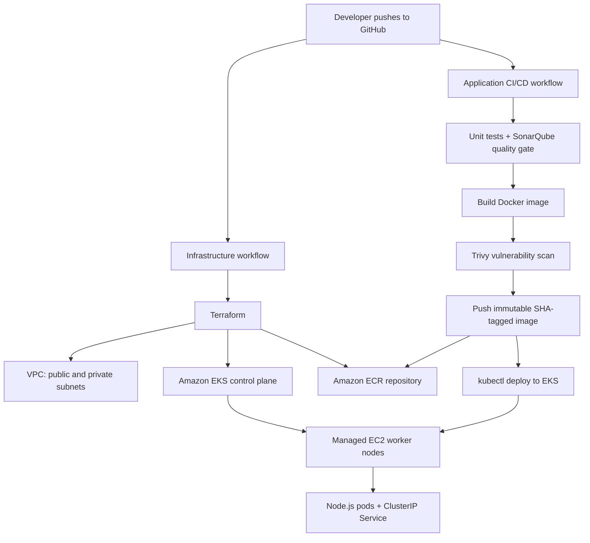

# CloudCart: Node.js + Docker + Terraform + EKS + GitHub Actions OIDC

A hands-on sample DevSecOps project. It includes a small Node.js e-commerce demo, Dockerfile, Terraform for a VPC/EKS/ECR, Kubernetes manifests, and separate GitHub Actions workflows for infrastructure and application deployment.

> This is a learning/demo baseline, not a fully production-hardened platform. Review IAM policies, EKS endpoint exposure, SonarQube connectivity, action versions, Terraform plans, and AWS costs before using it for production.

## Architecture



## Repository contents

- `app/`: Node.js Express API and simple e-commerce frontend
- `terraform/`: VPC, ECR, EKS managed node group and remote-state configuration
- `kubernetes/`: namespace, ConfigMap, Deployment and Service
- `.github/workflows/infrastructure.yml`: provisions AWS infrastructure
- `.github/workflows/deploy.yml`: tests, scans, pushes, deploys the app and auto-rolls back on failure
- `.github/workflows/rollback.yml`: manual rollback

## Prerequisites

- AWS account and AWS CLI
- Terraform 1.6+
- Docker
- kubectl
- GitHub repository
- IAM permissions to create the initial OIDC provider/roles and remote state bucket

## 1. Configure Terraform remote state

Create a dedicated private S3 bucket with versioning and encryption. Follow `terraform/README.md`. Copy `terraform/backend.hcl.example` to `terraform/backend.hcl` and set your bucket. Do not commit a real state bucket name if your repository policy treats it as internal configuration.

## 2. Configure GitHub OIDC and variables

Follow `.github/workflows/README.md` to create the OIDC provider, trust policies, IAM roles and GitHub variables. Do not create or store long-lived AWS access keys for these workflows.

## 3. Create infrastructure first

In GitHub, run **Actions → Provision AWS infrastructure → Run workflow**. The workflow creates the VPC, ECR repository, EKS cluster, and managed worker nodes. Check the Terraform output for exact `cluster_name` and `ecr_repository_name`, then set GitHub variables `EKS_CLUSTER_NAME` and `ECR_REPOSITORY` to those values.

The Terraform role is the identity that creates the cluster. Before running the app workflow, grant the deployment role Kubernetes access using an EKS access entry and a least-privilege access policy/RBAC. See the IAM notes in `.github/workflows/README.md`. Without Kubernetes API authorization, `kubectl` will authenticate to AWS but receive `Forbidden`.

## 4. Run locally

```bash
cd app
npm install
npm test
npm start
```

Open `http://localhost:3000`. API endpoints:
- `GET /health`
- `GET /api/products`
- `GET /api/products/:id`
- `POST /api/checkout` with JSON `{"items":[{"productId":"p-100","quantity":1}]}`

Checkout is a demo only; it does not process payments or persist orders.

## 5. Build and run Docker locally

```bash
docker build -t cloudcart:local ./app
docker run --rm -p 3000:3000 cloudcart:local
```

Open `http://localhost:3000` and test `http://localhost:3000/health`.

## 6. Application deployment workflow

After infrastructure exists and the deployment IAM role has EKS access, push application changes to `main` or manually run **Build, scan, push and deploy**.

The workflow:
1. Checks out source, installs dependencies with `npm ci`, and runs tests with coverage.
2. Installs SonarQube (a throw-away `sonarqube:community` container on the runner), creates a token, scans the code and **fails if the quality gate fails**. Findings are uploaded as the `sonarqube-report` artifact.
3. Builds a Docker image tagged with the full Git commit SHA.
4. Scans with Trivy; the job fails on HIGH/CRITICAL findings. The Trivy action is pinned to a commit SHA (see Security notes).
5. Assumes an AWS IAM role using GitHub OIDC and pushes the image to ECR.
6. Updates kubeconfig, records the currently running revision, applies the manifests with the new image, and waits for the rollout.
7. Runs a health check from a temporary pod inside the cluster.
8. **Automatic rollback:** if the rollout or health check fails, the pipeline runs `kubectl rollout undo` to the revision recorded in step 6, waits for it to become healthy, and still marks the run as failed so you notice. Kubernetes also keeps old pods serving during a bad rollout (`maxUnavailable: 0`, readiness probes, `progressDeadlineSeconds: 180`).

### Manual rollback

If a bad release is noticed later, run **Actions → Manual rollback**. Leave `revision` empty to go back one version, or enter a number from the printed rollout history.

### About the SonarQube setup

SonarQube runs inside the pipeline job, so it needs no server and works on GitHub-hosted runners. The trade-off is that it is ephemeral: there is no history or dashboard after the run (use the uploaded report artifact). If you want a permanent server, host SonarQube yourself and replace the "Install and start SonarQube" and "Wait for SonarQube" steps with `SONAR_HOST_URL` (variable) and `SONAR_TOKEN` (secret).

The immutable ECR repository uses commit SHA tags. Do not push a mutable `latest` tag to this repository.

## 7. Access the app

The Service is `ClusterIP` by default. To test from your machine after configuring kubeconfig:

```bash
kubectl port-forward -n cloudcart svc/cloudcart 8080:80
```

Open `http://localhost:8080`. For internet-facing access, add an AWS Load Balancer Controller and an Ingress resource, or intentionally change the Service to `LoadBalancer` for a quick demo (which may create a billable load balancer).

## 8. Security notes

- OIDC removes the need for long-lived AWS access keys in GitHub.
- Use repository/branch-scoped trust policies and separate infrastructure and deploy roles.
- The EKS worker nodes run in private subnets; NAT is enabled by default for outbound access.
- The EKS API endpoint is publicly accessible in this demo. Restrict its CIDRs or use a private endpoint and a runner inside the VPC for production.
- **Trivy supply-chain incident (March 2026):** most `aquasecurity/trivy-action` tags (including old un-prefixed ones like `0.28.0`) were force-pushed to credential-stealing code, and Trivy v0.69.4 was malicious. This repo pins `trivy-action` to the commit SHA of the safe v0.35.0 release. If you ever ran an older version of this workflow, treat the secrets and AWS roles it could reach as exposed and rotate them. Pin other third-party actions to full SHAs too.
- Scan failures are intentional gates. Fix vulnerabilities or document reviewed, time-bound exceptions.
- Never commit `.env`, tokens, state files, or credentials.

## 9. Cost and cleanup

EKS control plane, EC2 nodes, NAT Gateway, ECR storage, and any load balancer can incur charges. Use a small test environment, check current regional pricing, and destroy resources when finished.

```bash
cd terraform
terraform init -backend-config=backend.hcl
terraform plan -destroy -out=destroy.tfplan
terraform apply destroy.tfplan
```

ECR repository deletion can fail while images remain because `force_delete = false`. Delete the images intentionally first if needed. Keep the state bucket and its versions until you have confirmed cleanup is complete.

## Troubleshooting

- **OIDC AccessDenied**: verify `id-token: write`, OIDC provider audience, exact repository/branch `sub`, and the assumed role ARN.
- **ECR push denied**: confirm ECR repository name/region and ECR upload permissions on the deployment role.
- **kubectl Forbidden**: IAM authentication is not the same as Kubernetes authorization. Add an EKS access entry/policy for the deployment role.
- **SonarQube never reaches UP**: check the `docker logs sonarqube` output in the job; the step already raises `vm.max_map_count`. **Quality gate fails**: open the `sonarqube-report` artifact for the issues.
- **Trivy fails**: inspect reported CVEs; the configured gate fails on HIGH/CRITICAL findings.
- **Pods ImagePullBackOff**: check image URI/tag, ECR region/account, and worker-node ECR pull permissions.
- **Pods not Ready**: inspect `kubectl describe pod -n cloudcart POD` and `kubectl logs -n cloudcart POD`.
- **Terraform backend init fails**: verify S3 bucket, region, state permissions, lockfile permissions, and `backend.hcl`.

## Important implementation notes

- ECR is provisioned before the app pipeline pushes the first image. This is why infrastructure and application workflows are separate.
- Do not run Terraform apply for every app code change.
- Terraform plan/apply from CI should use a reviewed production approval gate.
- Terraform module/provider versions are pinned or constrained in code; update them deliberately after reviewing compatibility.
